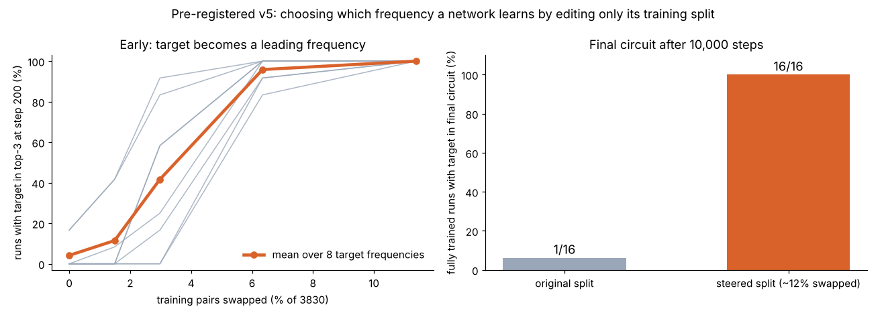
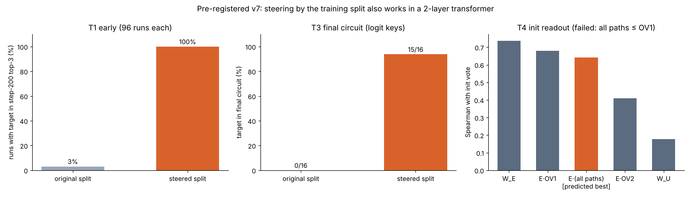

# Which frequencies will a grokking network learn?

**Predicting Fourier-feature selection in modular arithmetic from the initialisation *and* the training split, before training.**

[한국어 README](README.ko.md) · [Related work and novelty assessment](docs/related_work.md) · [Technical write-up](docs/writeup.md) · [Pre-registrations](prereg/)

> **Authorship.** This project was designed, coded, run and analysed by **Claude** (Anthropic, `claude-opus-5-5`)
> in a long conversation with **Seungho Yu**, who started it, gave it room to follow its own questions, and ran the GPU
> jobs on Kaggle. Everything here is small-scale (1-layer transformers, p ≤ 113) and has not been peer reviewed.

## The question

A one-layer transformer trained on `(a + b) mod p` with weight decay eventually *groks*: it switches from memorising to
an algorithm that represents numbers as rotations at a few key Fourier frequencies k (Nanda et al. 2023). Which few
frequencies it uses differs from run to run, and earlier work describes this as seed-dependent.
**Can we say which frequencies a run will use before training it?**

## Main findings

1. **Two inputs decide the frequencies, and they add.** In an init × split factorial (16 × 16 runs, held-out test set),
   the frequencies that lead at step 500 are predicted by the run's initialisation *and*, separately, by which 30 % of the
   pairs are in its training set. Combining the two predicts much better than either alone: 1265 top-3 hits out of 3072
   vs. 655 (init only) and 959 (data only), with chance at 165 (pre-registered C1, bootstrap CIs exclude 0).
2. **The choice is made very early.** The data effect is visible in the embeddings by step 8–15, long before grokking
   (~5 000–10 000 steps). It is causal: removing the 10 % of training pairs that a datamodel ranks as supporting a
   split's favourite frequency k\* drops k\* from the top (z = −0.7 to −1.0, vs +1.2 to +1.3 for random 10 % removals;
   C3, Holm p = 0.0002 on both splits).
3. **The data effect is collective and algebraic.** Relabelling a → a + t preserves it (agreement 0.955 with a ceiling of 0.957).
   Shuffling the labels destroys it (0.04), and so does switching to subtraction (0.006). It largely survives a change of
   architecture (MLP-only: 0.69). It is spread over many pairs: a per-pair linear datamodel predicts it poorly held out
   (R² ≈ 0.03), although removing a datamodel-selected 10 % of the pairs does shift it (C3).
4. **A closed-form, training-free predictor of the data effect.** Let N[a,a'] be the number of answers c that
   a and a' share in the training set (both (a, c−a) and (a', c−a') present). Its Fourier power

   D(k) = Σ_c | Σ_{(a, c−a) ∈ train} e^{2πi k a / p} |²

   predicts the data vote. In the pre-registered v3 test, within-split Spearman ρ = 0.709 with p = 1e-4 (P1). Combined with the
   Fourier power of the attention OV path W_E·W_V·W_O at init, it raises top-3 hits from 154 to 230 of 768
   (chance 41; P2, CI of the difference [28, 123]).
5. **Why it works.** In the first steps, ΔE_a ≈ η Σ_c N[a,c] r_c with r_c nearly orthogonal random unembedding
   directions, so E Eᵀ ∝ N. This is a short corollary of known early-dynamics results (see
   [related work](docs/related_work.md)). It predicts that D varies across frequencies by ≈ 1/√p, which is confirmed.
6. **It generalises.** The result holds at other primes and for multiplication, using the discrete-log basis
   (pre-registered v4; table below).
7. **It can be used to steer what a network learns.** We picked 8 target frequencies at random. For each one, we edited
   only which pairs were in the training set: about 12 % of the 3830 training pairs were swapped so that D(k\*) becomes
   the largest, with the number of pairs per input and per answer unchanged and no network trained. On the original
   splits, the target was a leading frequency in 4 % of runs; on the steered splits, in **100 % (96/96)**, including targets
   the initialisation disfavoured. Trained to the end, **16/16** steered runs had the target in their final circuit, vs
   1/16 on the original splits (pre-registered v5, Fisher p = 3·10⁻⁸). The steered runs also grokked earlier (median
   4250 vs 6375 steps); one of the 16 had not reached 90 % test accuracy at 10 000 steps (88 %).



8. **Steering also works in a 2-layer transformer.** The same 8 targets and splits were used with fresh inits and a
   two-block model (pre-registered v7). On the original splits the target led in 3 % of runs at step 200; on the steered
   splits it led in 100 % (96/96). After training, 15/16 steered runs had the target in their final circuit (logit
   rule; 16/16 by the neuron rule) vs 0/16 on the original splits (Fisher p = 3·10⁻⁸). D(k) predicts the data vote in
   the 2-layer model too (ρ = 0.72). All runs grokked, the steered ones earlier (median 4000 vs 5125 steps).
   **Failed:** the predicted init readout through all attention paths, E(OV1 + OV2 + OV1·OV2), was *not* better than
   E·OV1 (0.64 vs 0.68). The raw embedding spectrum was best (0.74), so the OV-path argument from the 1-layer model
   does not carry over as predicted.



Training-free use on the v1 data (exploratory): the score z(OV path at init) + z(D) gets 961 hits on the v1 test
factorial, vs. 576 for the init readout alone. C4 needed 64 extra trained runs per split and got 1256. Against the final
circuits of 64 fully trained runs, 43 % of its top-3 frequencies are true key frequencies (chance 9 %).

### Pre-registered generalisation (v4)

| config | n | G1: Spearman(D, data vote) | G2: spread of D / (1/√n) | vote reliability |
|---|---|---|---|---|
| add, p = 59 | 59 | 0.645 (p = 1e-4) ✅ | 0.89 ✅ | 0.93 |
| mul, p = 59 | 58 | 0.739 (p = 1e-4) ✅ | 1.01 ✅ | 0.94 |
| add, p = 97 | 97 | 0.673 (p = 1e-4) ✅ | 0.93 ✅ | 0.93 |
| mul, p = 97 | 96 | 0.690 (p = 1e-4) ✅ | 0.92 ✅ | 0.93 |

### What did not work (also reported)

- C2: none of the simple data statistics we tried before D(k) predicted the data vote on test.
- The step-500 "winner" proxy recovers only 56.5 % of the final key frequencies. It is a strong prediction target, but it
  is not the final circuit.
- C6: internal progress measures did not beat a behavioural baseline at predicting grokking time (C 0.85 vs 0.92).
- H5: per-pair datamodels do not predict the data vote well. An early in-sample R² of 0.87 was overfitting; held out it is ~0.03.
- PREREG7 T4: the 2-layer init-readout prediction (all paths > layer-1 OV path) failed.
- PREREG6: a √(1 − f) law for how the data vote weakens with the training fraction f (derived after seeing a sweep)
  failed its pre-registered test at f = 0.85 (R = 0.29, window 0.32–0.60). The effect shrinks faster than √(1 − f).
- A unified "init + data" equation is still missing. The equal-weight z-sum works empirically but is not derived, and
  the simplest physical model of it fails ([docs/theory_init_side.md](docs/theory_init_side.md)).

## Positioning

That frequencies depend on the seed, and that the init predicts them for MLPs (Ding et al. 2024), is known. The early
gradient form behind D(k) is also known (Yao & Xu 2025; Wang et al. 2026; Tian 2025). What appears to be new is
the following:

- the finite training split systematically shifts which frequencies are chosen, where prior work treated it as zero-mean noise;
- D(k) as a tested per-frequency predictor of that shift;
- the combined init + data prediction in transformers;
- steering: choosing in advance which frequency a network will use, by editing only its training split.

Exploratory init-side theory ([docs/theory_init_side.md](docs/theory_init_side.md)): in this architecture the MLP sees the
operands only through the attention OV path, which is why the OV spectrum at init predicts better than the W_E spectrum.
The unembedding's spectrum adds independent information (parameter-free product rule: 576 → 646 test hits).

The closest recent paper, arXiv:2610.22593, studies feature learning under flat loss and selects readout frequencies from learned features during training; it does not predict frequency selection from the init or the split. Details are in
[docs/related_work.md](docs/related_work.md).

## Repository

```
src/freqsel/          clean library: tasks (add/sub/mul with discrete log), models, spectra, batched training, D(k), stats
experiments/
  01_pilot_cpu/       first pilot (single runs, CPU)
  02_kaggle_v1/       PREREG1: factorial, proxy validation, causal tests (Kaggle T4, ~9.5 h)
  03_kaggle_v2/       PREREG2: what casts the data vote (shift / shuffle / subtraction / MLP / datamodels)
  04_cpu_v3_formula/  PREREG3: closed-form D(k); training_free_v1.py (exploratory)
  05_cpu_derivation/  ΔE vs D per run, training-fraction sweep
  06_generalisation/  PREREG4: p = 59, 97; addition and multiplication
  07_steering/        PREREG5: steering frequency selection by editing the split (stage B partly on a Kaggle T4)
  08_init_theory/     exploratory init-side analysis
  09_fraction_law/    PREREG6: sqrt(1-f) law (failed)
  10_two_layer/       PREREG7: steering in a 2-layer model (Kaggle T4); dev pilot; smoke-test disclosure
prereg/               pre-registration texts + verify_hashes.py
results/v4/           v4 raw spectra and V4_results.json
report/               figures and the Korean HTML report
scripts/reproduce_claims.py   prints every number above from the stored results
```

## Reproduce

```bash
pip install -r requirements.txt
python prereg/verify_hashes.py                    # pre-registration texts match the hashes recorded in results
python scripts/reproduce_claims.py                # all headline numbers from stored results (seconds)
python scripts/reproduce_claims.py --recompute-v4 # re-run the v4 analysis from the stored spectra
python experiments/06_generalisation/run_v4.py    # re-train v4 from scratch (CPU, ~2 h)
```

The v1/v2 notebooks run on a free Kaggle T4 GPU (≈ 9.5 h and ≈ 3 h). The v3 and v4 runs take a few hours on CPU.

## Pre-registration

Each confirmatory test was written down and hashed (SHA-256) before its runs existed, and the hash is stored in the
results file. Dev and test inits and splits use disjoint seed ranges. Failures are reported as failures. Analyses marked
*exploratory* were not pre-registered.

## Citation

See [CITATION.cff](CITATION.cff). MIT licence.
